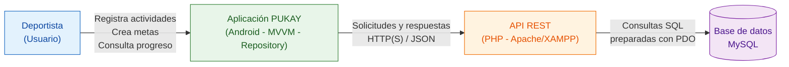

# PUKAY | Dossier de Arquitectura de Software

### Sistema móvil de seguimiento de actividades deportivas

---

## Integrantes del proyecto

- **Oscar Hernán Arévalo Narváez**
- **Kelly Johana Mora Arteaga**
- **Katherin Siza Imbaquingo**

---

## 1. Descripción del proyecto

**PUKAY** es una aplicación móvil desarrollada para Android, orientada al registro, seguimiento y control de actividades deportivas.

El sistema permite a los deportistas registrar sus actividades físicas, establecer metas personales y consultar su progreso.

Este repositorio contiene el **Dossier de Arquitectura de Software de PUKAY**, en el que se documentan las decisiones técnicas, la organización de los componentes y las tecnologías utilizadas.

La documentación se estructura mediante el modelo C4 y los registros de decisiones arquitectónicas (ADR).

---

## 2. Objetivo del proyecto

Diseñar y documentar una arquitectura de software organizada, mantenible y escalable para el sistema PUKAY, estableciendo una comunicación entre la aplicación móvil Android, una API REST desarrollada en PHP y una base de datos MySQL.

### Objetivos específicos

- Identificar los principales requisitos y drivers arquitectónicos.
- Representar la arquitectura mediante diagramas C4.
- Documentar las decisiones arquitectónicas mediante ADR.
- Establecer la comunicación cliente-servidor utilizando una API REST.
- Implementar persistencia de datos mediante MySQL.
- Registrar el uso de herramientas de inteligencia artificial durante la documentación.

---

## 3. Tecnologías utilizadas

| Componente | Tecnología |
|---|---|
| Aplicación móvil | Android / Java |
| Entorno de desarrollo | Android Studio |
| Arquitectura móvil | MVVM + Repository |
| Backend | PHP |
| Comunicación | API REST / JSON |
| Servidor de desarrollo | Apache / XAMPP |
| Base de datos | MySQL |
| Acceso a datos | PDO / SQL preparado |
| Diagramas | Mermaid / Modelo C4 |
| Documentación | Markdown |
| Control de versiones | Git / GitHub |

---

## 4. Arquitectura general del sistema

PUKAY utiliza una arquitectura cliente-servidor en la que la aplicación móvil se comunica con una API REST encargada de procesar las solicitudes y acceder a la base de datos MySQL.


### Diagrama de arquitectura




### Funcionamiento general

1. El deportista interactúa con la aplicación móvil PUKAY.
2. La aplicación envía solicitudes a la API REST.
3. La API desarrollada en PHP procesa las solicitudes.
4. La API consulta o modifica información en MySQL mediante PDO.
5. El servidor devuelve respuestas JSON a la aplicación.
6. PUKAY presenta los resultados al deportista.

---

## 📚 5. Documentación del repositorio

En esta sección se encuentran los enlaces a los documentos que conforman el dossier de arquitectura.

### 5.1. Contexto y drivers arquitectónicos

Documento que describe el contexto del sistema, sus necesidades y los factores que influyen en las decisiones de arquitectura.

📄 **[Ver contexto y drivers arquitectónicos](01-contexto-y-drivers.md)**

### 5.2. Vistas de arquitectura C4

Los diagramas C4 permiten representar visualmente la arquitectura del sistema desde diferentes niveles de abstracción.

**C4 Nivel 1 — Contexto del sistema**

Identifica al deportista como usuario principal y su interacción con PUKAY.

 **[Ver diagrama C4 Nivel 1](02-vistas-c4/c4-nivel1.md)**

**C4 Nivel 2 — Contenedores**

Representa los principales contenedores del sistema: aplicación Android, API REST y base de datos MySQL.

 **[Ver diagrama C4 Nivel 2](02-vistas-c4/c4-nivel2.md)**

### 5.3. Decisiones arquitectónicas (ADR)

Los ADR documentan las decisiones técnicas relevantes, su contexto y justificación.

**ADR-001 — Persistencia de datos con MySQL**

Documenta la elección de MySQL como sistema de almacenamiento persistente.

 **[Ver ADR-001](03-adr/ADR-001-persistencia-mysql.md)**

**ADR-002 — Autenticación y seguridad**

Describe la decisión arquitectónica relacionada con la protección de credenciales y autenticación.

 **[Ver ADR-002](03-adr/ADR-002-autenticacion-hash-token.md)**

**ADR-003 — Arquitectura cliente-servidor**

Documenta la comunicación entre la aplicación Android y el backend mediante una API REST.

🌐 **[Ver ADR-003](03-adr/ADR-003-cliente-servidor-api-rest.md)**

### 5.4. Registro de inteligencia artificial

Documento que registra la utilización de herramientas de inteligencia artificial durante el desarrollo de la documentación arquitectónica.
 **[Ver registro de uso de IA](04-registro-ia.md)**

---


## 6. Estructura del repositorio

La documentación del proyecto PUKAY se encuentra organizada de la siguiente manera:

```text
docs/
│
├── README.md
│
├── 01-contexto-y-drivers.md
│
├── 02-vistas-c4/
│   ├── c4-nivel1.md
│   └── c4-nivel2.md
│
├── 03-adr/
│   ├── ADR-001-persistencia-mysql.md
│   ├── ADR-002-autenticacion-hash-token.md
│   └── ADR-003-cliente-servidor-api-rest.md
│
└── 04-registro-ia.md
```


## 7. Seguridad y persistencia

La arquitectura de PUKAY contempla mecanismos para el manejo de información y la protección de los datos.

- Uso de consultas SQL preparadas mediante PDO.
- Separación entre aplicación móvil, lógica del servidor y base de datos.
- Tratamiento de credenciales mediante mecanismos de hash.
- Comunicación de datos mediante una API REST.
- Respuestas estructuradas en formato JSON.

Las decisiones y sus justificaciones se encuentran documentadas en los archivos ADR correspondientes.

---

## 8. Metodología de documentación

La documentación arquitectónica se organiza utilizando:

**Modelo C4**

- Nivel 1: Contexto del sistema.
- Nivel 2: Contenedores del sistema.

**Architecture Decision Records (ADR)**

- Contexto de la decisión.
- Alternativas consideradas.
- Decisión adoptada.
- Justificación y consecuencias.

**Markdown y Mermaid**

Permiten mantener la documentación y los diagramas directamente en GitHub, facilitando su lectura, actualización y control de versiones.

---

## 9. Resumen del dossier

| Documento | Contenido |
|---|---|
| Contexto y drivers | Requisitos y factores arquitectónicos |
| C4 Nivel 1 | Contexto general de PUKAY |
| C4 Nivel 2 | Contenedores y comunicaciones |
| ADR-001 | Persistencia con MySQL |
| ADR-002 | Autenticación y seguridad |
| ADR-003 | Arquitectura cliente-servidor |
| Registro IA | Uso de inteligencia artificial |

---

## 10. Conclusión

El dossier de arquitectura de PUKAY permite comprender la organización técnica del sistema, sus principales componentes y las decisiones arquitectónicas adoptadas.

La documentación mediante diagramas C4 y registros ADR facilita el análisis, mantenimiento y evolución del sistema, proporcionando una base para futuras mejoras.

---

### PUKAY
**Dossier de Arquitectura de Software**

*Documentación técnica del sistema de seguimiento deportivo.*
