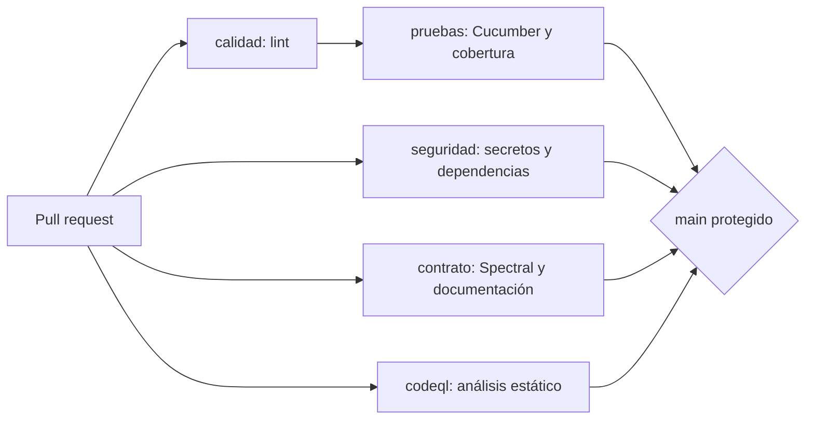

# Informe Final — PUKAY: Arquitectura, Cadena CASE, Versionamiento y Automatización

> **Módulo 8:** Automatización de Procesos de Software · Maestría en Ingeniería de Software · UPEC
> **Equipo:** Oscar Arévalo, Katherin Siza y Kelly Mora
> **Repositorio:** [kellymoraj8-ops/dossier-pukay](https://github.com/kellymoraj8-ops/dossier-pukay)


## Contenido

1. [Resumen del caso y su alcance](#1-resumen-del-caso-y-su-alcance)
2. [Arquitectura](#2-arquitectura-drivers-escenarios-y-decisiones)
3. [Cadena CASE](#3-cadena-case)
4. [Versionamiento](#4-versionamiento)
5. [Automatización](#5-automatización-pipeline-quality-gates-y-evidencia)
6. [Métricas aproximadas tipo DORA](#6-métricas-aproximadas-tipo-dora)
7. [Uso de IA](#7-uso-de-ia)
8. [Análisis crítico y lecciones aprendidas](#8-análisis-crítico-y-lecciones-aprendidas)
9. [Referencias](#9-referencias)
10. [Anexo A. Apartado técnico: pipeline de integración continua](#anexo-a-apartado-técnico-pipeline-de-integración-continua)
11. [Anexo B. Script de métricas DORA](#anexo-b-script-de-métricas-dora)

---

## 1. Resumen del caso y su alcance

**PUKAY** es una aplicación móvil nativa para Android orientada al registro y seguimiento de actividades deportivas y metas personales. Permite registrarse, iniciar sesión, elegir disciplinas, registrar entrenamientos, consultar el historial y seguir objetivos. Su arquitectura es cliente-servidor: la aplicación Android (Java, XML, MVVM con Repository) consume una API REST en PHP (Apache de XAMPP, acceso a datos con PDO) que persiste en MySQL. Más detalle en el [caso PUKAY](01-contexto-y-drivers/A%29Caso-pukay.md).

**Qué cubre este informe.** Integra el trabajo de cuatro semanas: el dossier de arquitectura (Semana 1), la cadena CASE (Semana 2), la gestión de versiones (Semana 3) y la automatización con integración continua (Semana 4). Todo está enlazado a los artefactos del repositorio en lugar de copiarse.

**Alcance real y sus límites.** Hay dos piezas de software distintas y conviene no confundirlas:

| Pieza | Tecnología | ¿Está en este repositorio? | ¿La ejecuta el pipeline? |
|---|---|---|---|
| Aplicación Android | Java, XML, MVVM + Repository | [INSERTAR AQUÍ ENLACE AL REPOSITORIO O CARPETA DEL CÓDIGO ANDROID, O ESCRIBIR «NO VERSIONADO EN ESTE REPOSITORIO»] | No |
| API REST y base de datos | PHP, PDO, MySQL | [INSERTAR AQUÍ ENLACE AL REPOSITORIO O CARPETA DEL CÓDIGO PHP, O ESCRIBIR «NO VERSIONADO EN ESTE REPOSITORIO»] | No |
| Esqueleto ejecutable de la cadena CASE | Node.js (ADR-005) | Sí: [`src/`](../src/) y [`tests/`](../tests/) | **Sí** |

El esqueleto Node.js reproduce el contrato OpenAPI de PUKAY con un almacén en memoria y sirve para ejercitar toda la cadena (contrato, pruebas de aceptación, análisis estático, pipeline). **No prueba el código PHP ni el Android.** Cada vez que este informe habla de «pruebas aprobadas» se refiere al esqueleto y al contrato.

---

## 2. Arquitectura: drivers, escenarios y decisiones

### 2.1. Drivers

Cinco drivers priorizados por importancia y dificultad (ver [drivers arquitectónicos](01-contexto-y-drivers/E%29Drivers-arquitectonicos.md)):

| ID | Driver | Atributo (ISO/IEC 25010:2023) | Importancia |
|---|---|---|---|
| D1 | Proteger las credenciales del usuario y las comunicaciones | Seguridad | Alta |
| D2 | Aislar los datos de cada usuario | Seguridad | Alta |
| D3 | Localizar el impacto de los cambios en una sola capa | Mantenibilidad | Alta |
| D4 | Permitir que otros clientes reutilicen el backend | Interoperabilidad | Alta |
| D5 | Registrar actividades en pocos pasos y mostrar el progreso sin cálculos manuales | Capacidad de interacción | Media |

Las restricciones (R1 a R6) están en [restricciones y supuestos](01-contexto-y-drivers/D%29restricciones-supuestos.md); las principales son el uso obligatorio de API REST, XAMPP y MySQL (R1), el acceso a la base solo desde el backend (R2) y el plazo de dos semanas (R3).

### 2.2. Escenarios de calidad

Cada escenario sigue el modelo de seis partes (fuente, estímulo, entorno, artefacto, respuesta, medida). Definición completa en [escenarios de calidad](01-contexto-y-drivers/F%29Escenarios-calidad.md).

| Escenario | Atributo | Driver | Medida propuesta | ¿Hay verificación automática? |
|---|---|---|---|---|
| E1 | Seguridad | D1 | 0 usuarios con contraseña en texto plano; 100 % con hash y sal | **Sí**: CP06 y CP01, job `pruebas` |
| E2 | Seguridad | D2 | 0 registros ajenos; 100 % de peticiones sin token reciben 401 | **Sí**: CP07, CP12 y HU6, job `pruebas` |
| E3 | Mantenibilidad | D3 | 0 archivos de interfaz modificados; 4 horas-persona o menos | No (depende del código Android) |
| E4 | Interoperabilidad | D4 | 9 de 9 recursos utilizables sin modificar el backend | Parcial: el contrato se valida en el job `contrato` |
| E5 | Capacidad de interacción | D5 | 3 pantallas o menos y 60 s o menos | Solo la lógica de negocio (CP09, CP10, CP17) |
| E6 | Disponibilidad | — | [INSERTAR AQUÍ LA DEFINICIÓN DE E6 O ESCRIBIR «PENDIENTE DE DEFINIR»] | No |

Las medidas son objetivos de evaluación propuestos con apoyo de IA, no resultados medidos.

### 2.3. Decisiones principales y sus ADR

| ADR | Decisión | Protege | Alternativas descartadas |
|---|---|---|---|
| [ADR-001](03-adr/ADR-001-persistencia-mysql.md) | Persistencia centralizada en MySQL con acceso exclusivo desde el backend; el progreso se calcula en cada consulta | E5 | Base local, NoSQL en la nube, archivos |
| [ADR-002](03-adr/ADR-002-autenticacion-hash-token.md) | Contraseñas guardadas como hash con sal y token de autenticación; HTTPS | E1, E2 | Texto plano, cifrado reversible, autenticación delegada |
| [ADR-003](03-adr/ADR-003-cliente-servidor-api-rest.md) | Cliente-servidor con API REST y MVVM más Repository en el cliente | E3, E4, E6 | Aplicación autónoma (A1), backend como servicio (A3), Clean Architecture completa |
| [ADR-004](03-adr/ADR-004-seleccion-git.md) | Git y GitHub como control de versiones con GitHub Flow | Proceso | Subversion (SVN) |
| [ADR-005](03-adr/ADR-005-stack-del-esqueleto.md) | Esqueleto de la cadena CASE en Node.js sin base de datos | Proceso | PHP con PHPUnit, Python con pytest |

El estilo cliente-servidor (alternativa A2) se eligió por su puntuación en la matriz ponderada (4,25 frente a 3,40 de A1 y 3,35 de A3, según el ADR-003). Las alternativas están en [alternativas arquitectónicas](05-evaluacion-arquitectonica/01-alternativas-arquitectonicas.md) y las vistas en [C4 nivel 1](02-vistas-c4/c4-nivel1.md) y [C4 nivel 2](02-vistas-c4/c4-nivel2.md).

**Trazabilidad.** La relación completa requisito → escenario → ADR → artefacto → commit o PR → pipeline está en [`05-trazabilidad.md`](05-trazabilidad.md).

---

## 3. Cadena CASE

### 3.1. Mapa de toolchain

El [mapa de toolchain](06-mapa-toolchain.md) distingue ocho fases del ciclo de vida y asocia a cada una una herramienta:

| Fase | Herramienta | Categoría CASE |
|---|---|---|
| Análisis de requisitos | ChatGPT | Upper CASE |
| Diseño arquitectónico | Mermaid | Upper CASE |
| Diseño de API | Swagger Editor | Upper CASE |
| Implementación | Android Studio y VS Code | Lower CASE |
| Integración | Postman | I-CASE (función de integración) |
| Pruebas | Cucumber y Spectral | Lower CASE |
| Documentación | GitHub, Swagger UI y Redocly | I-CASE (función de integración) |
| Control de versiones | Git y GitHub | I-CASE (función de integración) |

Se identificaron diez tareas de alto volumen y se priorizaron con la fórmula frecuencia × esfuerzo × riesgo (máximo 125). Las tres primeras son: historias y criterios de aceptación (T-01, 125), contrato OpenAPI (T-02, 100) y pruebas automatizadas de la API (T-03, 100).

### 3.2. Herramientas seleccionadas y matriz de evaluación

La [matriz de evaluación](10-matriz-evaluacion-case.md) comparó tres herramientas con cinco criterios ponderados (adecuación funcional 30 %, facilidad de uso 15 %, integración 20 %, verificación 25 %, riesgo y control 10 %):

| Herramienta | Tarea | Resultado | Condición de uso |
|---|---|---|---|
| ChatGPT | T-01 | 72 % | Revisión humana obligatoria |
| Swagger Editor (con Spectral) | T-02 | 90 % | Validar con Spectral |
| Cucumber | T-03 | 92 % | Mantener escenarios vinculados a criterios |

En la Semana 4 la cadena se amplió con herramientas que no estaban en la matriz y que sostienen el pipeline: **ESLint** (calidad del código), **Spectral** (reglas del contrato, ahora con umbral `warn`), **Redocly** (generación de la documentación de la API), **c8** (cobertura), **CodeQL** (análisis estático) y **GitHub Actions** (orquestación).

### 3.3. Análisis crítico de las herramientas

- **Las calificaciones son valoraciones del propio equipo**, no mediciones independientes. Cucumber sale primero (92 %) en buena parte porque su resultado es ejecutable y verificable; ChatGPT sale último porque su salida exige revisión, no porque sea inútil.
- **La cadena entera se evaluó sobre el prototipo Node.js.** Cucumber, Spectral, ESLint y CodeQL no ven el código PHP ni el Java. La cadena CASE demostró funcionar, pero sobre un sustituto del producto.
- **Una herramienta puede dar una falsa seguridad.** Spectral aprobó el contrato mientras el archivo `.spectral.yaml` nunca se había confirmado en el repositorio: la prueba funcionaba solo en el computador donde se creó. Lo detectó la reproducción en un entorno limpio, que es exactamente lo que hace un pipeline.

---

## 4. Versionamiento

### 4.1. Flujo de ramas elegido

El equipo adoptó **GitHub Flow** ([ADR-004](03-adr/ADR-004-seleccion-git.md) y [`CONTRIBUTING.md`](../CONTRIBUTING.md)): una rama corta por tarea a partir de `main`, commits con Conventional Commits (`feat`, `fix`, `docs`, `test`, `refactor`, `chore`, `ci`), Pull Request con revisión de otro integrante y eliminación de la rama al fusionar. Convención de nombres: `feature/`, `fix/`, `docs/`, `test/`, `chore/`.

La rama `main` está protegida mediante Pull Requests y aprobaciones, y [`CODEOWNERS`](../.github/CODEOWNERS) asigna responsables por área (`/docs/`, `/api/`, `/src/`, `/tests/`).

### 4.2. Conflicto documentado

Se provocó y resolvió un conflicto real: dos ramas (`test/conflicto-oscar` y `test/conflicto-kelly`) modificaron la misma línea de `evidencias/prueba-conflicto-git.md`. GitHub bloqueó la fusión del [Pull Request #16](https://github.com/kellymoraj8-ops/dossier-pukay/pull/16) con el mensaje «This branch has conflicts that must be resolved»; el equipo lo resolvió con el editor de conflictos conservando los aportes de ambos. Detalle y capturas en [`12-resolucion-conflicto-git.md`](12-resolucion-conflicto-git.md) y en el [Issue #13](https://github.com/kellymoraj8-ops/dossier-pukay/issues/13).

### 4.3. Decisión Git frente a SVN (ADR-004)

Se eligió Git por su modelo distribuido, sus ramas baratas, la revisión mediante Pull Requests, la protección de ramas y la integración con GitHub Actions. SVN sigue siendo válido para organizaciones con administración centralizada y permisos por directorio. El análisis comparativo está en [`08-matriz-git-vs-svn.md`](08-matriz-git-vs-svn.md).

### 4.4. Versionado semántico

El proyecto usa SemVer: se publicó la [versión v0.3.0](https://github.com/kellymoraj8-ops/dossier-pukay/releases/tag/v0.3.0). Observaciones sobre el estado actual: el [`CHANGELOG.md`](../CHANGELOG.md) conserva una fecha sin completar en la entrada 0.2.0 y no registra la 0.3.0, y `package.json` indica la versión 0.2.0. Son desajustes menores pero reales entre la versión publicada y la declarada.

---

## 5. Automatización: pipeline, quality gates y evidencia

### 5.1. Qué se automatizó y por qué

Se aplicó un criterio de tres preguntas: ¿la tarea se repite?, ¿hay una regla clara que decida si está bien o mal? y ¿un error cuesta caro? Si las tres respuestas son afirmativas, se automatiza; si exige criterio, decide una persona (por ejemplo, la revisión del diseño en un Pull Request).

El pipeline vive en un archivo del repositorio, [`.github/workflows/ci.yml`](../.github/workflows/ci.yml), y se ejecuta en cada Pull Request, en cada push a `main` y cada lunes a las 06:00 UTC (porque aparecen vulnerabilidades nuevas aunque el código no cambie). El código completo está en el [Anexo A](#anexo-a-apartado-técnico-pipeline-de-integración-continua).



### 5.2. Las seis puertas de calidad

| N.º | Puerta | Job | Herramienta y comando | Falla cuando |
|---|---|---|---|---|
| 1 | Formato y lint | `calidad` | ESLint: `npm run lint` | Hay variables sin usar, comparaciones inseguras u otras reglas incumplidas |
| 2 | Pruebas | `pruebas` | Cucumber: `npm run cobertura` | Un escenario de aceptación falla |
| 3 | Cobertura | `pruebas` | c8 con umbral de 80 % de líneas | La cobertura baja de 80 % |
| 4 | Análisis estático | `codeql` | CodeQL para JavaScript | Se encuentran alertas de seguridad |
| 5 | Seguridad | `seguridad` | `npm run secretos` y `npm audit --omit=dev` | Hay un posible secreto en el código o una dependencia de ejecución con gravedad alta o crítica |
| 6 | Contrato y documentación | `contrato` | Spectral (`--fail-severity=warn`) y Redocly | El contrato incumple las reglas (incluidas advertencias) o la documentación no compila |

**Decisiones de configuración que merecen explicación:**

- **Umbral de cobertura del 80 %, no del 90 %.** La cobertura real del prototipo es 82,1 % de líneas. Un umbral de 90 % bloquearía todos los Pull Request desde el primer día. El 80 % es una línea base medida, no una meta; subirlo es una decisión futura.
- **La auditoría revisa solo las dependencias de ejecución.** `npm audit` completo informa 19 vulnerabilidades (13 altas, 6 moderadas), todas en `@stoplight/prism-cli` y `@openapitools/openapi-generator-cli`, que son herramientas de desarrollo. El prototipo no tiene dependencias de ejecución, así que `--omit=dev` da 0. Esta puerta es, por tanto, débil por construcción: el riesgo de las herramientas de desarrollo se acepta de forma documentada.
- **Spectral falla también con advertencias** (`--fail-severity=warn`), más estricto que la configuración de la Semana 2, que solo miraba errores.
- **Permisos mínimos.** El workflow declara `permissions: contents: read`; solo el job `codeql` agrega `security-events: write` y `actions: read`.
- **Acciones fijadas a un commit de 40 caracteres**, con la etiqueta como comentario. Una etiqueta como `@v4` es un puntero que su dueño puede mover.
- **Sin secretos.** El pipeline no necesita ninguno.

### 5.3. Protección de `main`

Los cinco checks (`calidad`, `pruebas`, `seguridad`, `contrato`, `codeql`) se declaran obligatorios en la regla de `main`, junto con Pull Request previo, una aprobación y rama actualizada. Sin esa regla las puertas solo avisarían: un Pull Request en rojo todavía se podría integrar. La configuración paso a paso está en el [Anexo A.8](#a8-protección-de-main).

Aunque `pruebas` depende de `calidad` (`needs`), si `calidad` falla GitHub marca `pruebas` como omitido; como `calidad` también es obligatorio, el bloqueo se mantiene.

**Evidencia:** [INSERTAR ENLACE A LA CAPTURA DE LA REGLA DE PROTECCIÓN DE main EN LA CARPETA evidencias/]. La evidencia de la Semana 3 ([`prueba-proteccion-main.md`](../evidencias/prueba-proteccion-main.md)) figura como «Pendiente de verificación» y debe actualizarse.

### 5.4. Esqueleto ejecutable que corre por el pipeline

El job `pruebas` ejecuta Cucumber, que arranca el servidor HTTP del esqueleto (`crearServidor` en [`src/servidor.js`](../src/servidor.js)) en un puerto libre y lo consulta con peticiones reales (`fetch`) desde [`tests/steps/comunes.js`](../tests/steps/comunes.js). Es decir, el servicio corre de punta a punta dentro del runner de GitHub Actions, sin base de datos.

Las pruebas derivan de los criterios de aceptación:

| Elemento | Casos | Resultado de la verificación local |
|---|---|---|
| Caso principal **«registrar actividad»** (HU4) | CP09 (registro exitoso), CP10 (duración obligatoria), CP17 (valores negativos) | Aprobados |
| Escenario **E1** (contraseñas) | CP06 (no se almacena en texto plano) y CP01 (registro válido) | Aprobados |
| Suite completa | 17 escenarios y 96 pasos | 17 aprobados, 0 fallidos |

### 5.5. Falla provocada y corregida

Un pipeline que nunca se ha visto fallar no es de fiar. La prueba consiste en subir deliberadamente un secreto a una rama de prueba.

**Procedimiento:**

1. Crear la rama `prueba/secreto` desde `main`.
2. Agregar `src/config.js` con una contraseña escrita en el código (texto de ejemplo, nunca una clave real).
3. Ejecutar `npm run secretos` en el computador: detecta el problema antes de subirlo.
4. Confirmar y subir la rama; abrir el Pull Request.
5. Observar el resultado: el check `seguridad` queda en rojo y el botón de fusión se bloquea.
6. Corregir leyendo el valor desde una variable de entorno (`process.env.CLAVE_APP`), confirmar y subir a la misma rama.
7. Observar que los cinco checks pasan a verde.
8. Cerrar el Pull Request sin fusionar y borrar la rama.

Los comandos exactos están en el [Anexo A.7, pasos 8 y 9](#a7-paso-a-paso).

**Resultado esperado y resultado obtenido:**

| Momento | Esperado | Obtenido |
|---|---|---|
| Con el secreto | `seguridad` en rojo; fusión bloqueada | [INSERTAR AQUÍ LO QUE VIO: QUÉ CHECKS FALLARON Y EL MENSAJE DE BLOQUEO] |
| Tras la corrección | Cinco checks en verde; fusión habilitada | [INSERTAR AQUÍ LO QUE VIO TRAS CORREGIR] |

**Evidencia:** [INSERTAR ENLACE AL PR DE LA FALLA PROVOCADA]; capturas en `evidencias/`: [INSERTAR RUTAS DE LAS CAPTURAS DEL CHECK EN ROJO Y DEL CHECK EN VERDE].

**Lección de la prueba.** Corregir el archivo no borra el secreto del historial: el primer commit sigue existiendo en la rama del Pull Request. Si el valor hubiera sido una clave real, habría que revocarla y generar una nueva de inmediato. Por eso importa detectar el problema **antes** de confirmar el cambio (por ejemplo, con un hook local).

### 5.6. Estado de las evidencias del pipeline

| Evidencia | Estado |
|---|---|
| Cada comando del pipeline funciona sobre el repositorio (`lint`, `cobertura`, `secretos`, `auditoria`, `contrato`, `docs:redoc`) | Verificado en un entorno aislado sobre una copia del repositorio |
| Los cinco checks en verde en GitHub Actions | [INSERTAR ENLACE A UNA EJECUCIÓN DE CI EN VERDE] |
| Duración total del pipeline | [INSERTAR DURACIÓN TOTAL DEL PIPELINE EN MINUTOS] |
| Protección de `main` activa | [INSERTAR ENLACE A LA CAPTURA DE LA REGLA DE PROTECCIÓN DE main EN LA CARPETA evidencias/] |
| Falla provocada y corregida | [INSERTAR ENLACE AL PR DE LA FALLA PROVOCADA] |
| Insignia del estado en el README | [INSERTAR ENLACE AL README CON LA INSIGNIA VISIBLE] |

---

## 6. Métricas aproximadas tipo DORA

### 6.1. Qué se midió y con qué adaptaciones

DORA propone cinco métricas: tres de velocidad (tiempo de entrega de cambios, frecuencia de despliegue, tiempo de recuperación) y dos de estabilidad (tasa de fallos de cambios y tasa de retrabajo) (Forsgren et al., 2018). **PUKAY no se despliega en un servidor de producción**, así que se tomó cada release (etiqueta de Git) como equivalente a un despliegue y cada fusión en `main` como un cambio entregado. Los valores son aproximaciones y no deben compararse con los de equipos reales.

### 6.2. Cómo se calcularon

Los datos se extrajeron de GitHub con la herramienta de línea de comandos `gh` y se procesaron con [`scripts/dora.js`](../scripts/dora.js) (Anexo B). Periodo medido: [INSERTAR FECHA DE INICIO Y FECHA DE FIN DEL PERIODO MEDIDO].

| Métrica | Definición adoptada | Fuente |
|---|---|---|
| Tiempo de entrega de cambios | Mediana de horas entre la apertura de un Pull Request y su fusión en `main` | `gh pr list --state merged --json number,title,createdAt,mergedAt` |
| Frecuencia de despliegue | Releases (etiquetas) por semana, junto con Pull Request fusionados por semana | `git tag --list` y la misma lista de Pull Request |
| Tiempo de recuperación | Mediana de horas entre la primera ejecución fallida de CI en una rama y la siguiente ejecución exitosa de esa rama | `gh run list --workflow=ci.yml --json conclusion,createdAt,headBranch,event` |
| Tasa de fallos de cambios | Porcentaje de ejecuciones de CI con resultado fallido | La misma lista de ejecuciones |
| Tasa de retrabajo | Porcentaje de Pull Request fusionados cuyo título empieza con `fix` | La lista de Pull Request |

### 6.3. Resultados

| Métrica | Valor | Datos usados |
|---|---|---|
| Tiempo de entrega de cambios | [INSERTAR RESULTADO DE scripts/dora.js: FILA «TIEMPO DE ENTREGA»] | [INSERTAR NÚMERO DE PR FUSIONADOS USADOS] |
| Frecuencia de despliegue | [INSERTAR RESULTADO DE scripts/dora.js: FILA «FRECUENCIA»] | [INSERTAR NÚMERO DE RELEASES USADAS] |
| Tiempo de recuperación | [INSERTAR RESULTADO DE scripts/dora.js: FILA «RECUPERACIÓN»] | [INSERTAR NÚMERO DE RECUPERACIONES] |
| Tasa de fallos de cambios | [INSERTAR RESULTADO DE scripts/dora.js: FILA «FALLOS»] | [INSERTAR EJECUCIONES FALLIDAS Y TOTALES] |
| Tasa de retrabajo | [INSERTAR RESULTADO DE scripts/dora.js: FILA «RETRABAJO»] | [INSERTAR PR «fix» Y TOTAL] |

### 6.4. Interpretación y límites

[INSERTAR AQUÍ DOS O TRES FRASES PROPIAS INTERPRETANDO LOS VALORES OBTENIDOS: QUÉ MÉTRICA SALIÓ MEJOR Y CUÁL PEOR, Y POR QUÉ]

Límites que condicionan cualquier lectura:

- **Muy pocos datos.** Un equipo de tres personas en pocas semanas produce decenas de Pull Request como máximo; una mediana calculada con ellos es muy sensible a un solo valor extremo.
- **La falla provocada distorsiona la tasa de fallos y el tiempo de recuperación**: hay al menos una ejecución roja que se generó a propósito. Es válido incluirla si se declara.
- **Ley de Goodhart.** Si una métrica se convierte en meta, se manipula: dividir un cambio en commits triviales mejora el tiempo de entrega sin mejorar nada. Las métricas sirven para conversar sobre el proceso, no para evaluar personas.
- **No hay despliegue real**, por lo que «frecuencia de despliegue» mide cuántas versiones etiquetamos, no cuántas llegan a usuarios.

---

## 7. Uso de IA

El [registro de uso de IA](04-registro-ia.md) documenta 29 usos en seis tablas: dossier de arquitectura (Tablas 34 y 35), cadena CASE (Tabla 36 y 36-bis), gestión de versiones (Tabla 38) y pipeline (Tabla 39). Las herramientas fueron ChatGPT (GPT-4 y GPT-6) y Claude (3.5 Sonnet y Sonnet 5.5).

**Síntesis de lo registrado:**

| Decisión | Qué significó |
|---|---|
| **Aceptado** | Estructuras y organización (carpetas, tablas de escenarios) que coincidían con los requisitos |
| **Modificado** | La mayoría de los usos: historias incompletas, rutas genéricas del contrato, umbral de cobertura del 90 %, auditoría de dependencias que bloquearía todo |
| **Rechazado** | Elementos que no correspondían al modelo del proyecto (Room y DAO, tabla de sesiones, denominación PUKAY2) |

**Cómo se verificó.** Ninguna salida se aceptó por su apariencia. Se usaron cuatro mecanismos: contraste con el informe original y los requisitos, herramientas que ejecutan (Cucumber, Spectral, ESLint), reproducción de los comandos en un entorno limpio y consulta de las fuentes oficiales (por ejemplo, los commits reales de las acciones de GitHub con `git ls-remote`).

**Revisión del workflow generado por IA.** El `ci.yml` se revisó con una lista de verificación: permisos mínimos, acciones fijadas por versión, ausencia de secretos y ejecución real ([Tabla 40 del registro](04-registro-ia.md)). Los criterios de permisos, acciones fijadas, existencia de las acciones y ausencia de secretos se verificaron; la ejecución real en GitHub Actions se enlaza en la sección 5.6.

**Datos personales y credenciales.** No se ingresaron en ninguna herramienta de IA.

---

## 8. Análisis crítico y lecciones aprendidas

### 8.1. Qué funcionó

- **El pipeline detecta errores que la revisión humana pasaba por alto.** Antes de automatizar, un contrato válido y unas pruebas en verde parecían suficientes; al reproducirlo todo en un entorno limpio aparecieron un archivo de configuración sin versionar, una auditoría que no podía pasar y un patrón de secretos con falsos positivos.
- **El contrato OpenAPI como eje de la cadena.** Un mismo archivo sirvió para visualizar la API, validar reglas con Spectral, generar documentación con Redocly y orientar las pruebas.
- **Pruebas en lenguaje de negocio.** Los escenarios Gherkin hacen legible la relación entre criterio de aceptación y prueba, lo que permitió construir la matriz de trazabilidad con identificadores reales.
- **Decisiones documentadas con alternativas.** Los ADR obligaron a justificar y facilitaron explicar cada elección.

### 8.2. Qué no funcionó o quedó débil

- **El pipeline verifica un sustituto del producto.** Ningún job ejecuta PHP, Java ni la base de datos. CodeQL analiza solo el JavaScript del prototipo. Una insignia verde puede transmitir más confianza de la que corresponde.
- **El contrato y la implementación divergen.** El contrato documenta rutas PHP (`/login.php`, `/registrar_actividad.php`...) y cinco operaciones; el prototipo sirve además rutas propias (`/api/auth/registro`, `/api/deportes`...). Registro de usuario y catálogo de deportes no están en el contrato, y E4 habla de «9 de 9 recursos» mientras el contrato documenta cinco.
- **Los identificadores se desalinearon con el tiempo.** Dos criterios con la etiqueta `CA11`, dos ADR con el número 004, referencias a archivos con otros nombres y un README con enlaces rotos por diferencias de mayúsculas. Ninguna herramienta lo detecta; solo la revisión cuidadosa.
- **Atributos sin puerta automática.** E3 (cambios localizados) y E6 (servidor no disponible) no tienen verificación automática, y E6 ni siquiera está definido en la documentación.
- **Algunas puertas son débiles por construcción.** `npm audit --omit=dev` da cero porque no hay dependencias de ejecución; el umbral de cobertura se fijó en lo que ya se tenía; las pruebas HU6 comprueban funciones y no peticiones HTTP.
- **La seguridad del prototipo no equivale a la del producto.** El prototipo usa `scrypt` de Node para el hash; el backend PHP debe usar su propia función (por ejemplo `password_hash`) y el ADR-002 recomienda evolucionar a bcrypt o Argon2. [CONFIRMAR QUÉ FUNCIÓN DE HASH USA EL CÓDIGO PHP REAL Y ESCRIBIRLA AQUÍ]
- **Evidencias sin cerrar.** La revisión cruzada del dossier conserva marcadores sin completar y la prueba de protección de `main` figura como pendiente.

### 8.3. Qué cambiaríamos

1. **Pipeline para el producto, no solo para el prototipo:** `php -l` y pruebas con PHPUnit para la API; `./gradlew lint test` para la app Android; un servicio MySQL en el runner para probar el contrato contra el backend real (por ejemplo, con Prism o Schemathesis).
2. **Pruebas de contrato contra el servidor:** que el pipeline compare cada ruta del contrato con una petición real, para detectar la divergencia entre contrato e implementación.
3. **Validar identificadores automáticamente:** un script en el pipeline que falle si hay etiquetas `CA`, `CP` o `ADR` duplicadas o enlaces de Markdown rotos.
4. **Herramienta especializada para secretos** (por ejemplo Gitleaks) en lugar del escáner didáctico, y Dependabot para actualizaciones de acciones y dependencias.
5. **Subir el umbral de cobertura de forma gradual**, con un compromiso explícito del equipo (80 % hoy, 85 % después de agregar pruebas a `servidor.js`).
6. **Definir E6 y automatizar su verificación** (una prueba que apague el servidor y compruebe el comportamiento de la app).

### 8.4. Límites del proceso

- **La integración continua mide lo que se le pide.** Una puerta que nadie diseñó para detectar un defecto no lo detectará, por más verde que esté el tablero.
- **El tamaño de la muestra.** Tres integrantes, pocas semanas y un plazo fijo: las métricas DORA y las conclusiones sobre el proceso son indicativas, no concluyentes.
- **La automatización no reemplaza el criterio.** La arquitectura, la priorización y la revisión del diseño siguen siendo decisiones humanas; el pipeline solo vigila lo que se puede reducir a una regla.
- **Dependencia de la plataforma.** El flujo (Pull Requests, protección de ramas, Actions, CodeQL) depende de GitHub; CodeQL, además, exige un repositorio público o una licencia adicional. [CONFIRMAR SI EL REPOSITORIO ES PÚBLICO]

### 8.5. Lecciones aprendidas

1. **Reproducir en limpio antes de confiar.** Lo que funciona en el computador de quien lo creó no necesariamente funciona en otro; el pipeline convierte esa duda en una comprobación automática.
2. **Una puerta debe ser capaz de fallar.** Provocar fallas a propósito es la única forma de saber que el control realmente bloquea.
3. **Detectar antes es más barato.** Un secreto detectado antes del commit se evita; detectado después, obliga a revocar y regenerar.
4. **La IA acelera el borrador, la verificación es del equipo.** Las salidas de IA contenían valores genéricos y datos que no podía conocer; cada uno apareció al ejecutarlo o contrastarlo con una fuente oficial.
5. **Declarar el alcance con honestidad.** Es más valioso un informe que dice «esto se probó en el prototipo, no en el backend PHP» que uno que sugiere una cobertura que no existe.

---

## 9. Referencias

Forsgren, N., Humble, J., & Kim, G. (2018). *Accelerate: The science of lean software and DevOps*. IT Revolution Press.

Fowler, M. (2024). *Continuous integration*. martinfowler.com. https://martinfowler.com/articles/continuousIntegration.html

GitHub. (s. f.). *GitHub Actions documentation*. https://docs.github.com/actions

Humble, J., & Farley, D. (2010). *Continuous delivery: Reliable software releases through build, test, and deployment automation*. Addison-Wesley.

National Institute of Standards and Technology. (2023). *Artificial intelligence risk management framework (AI RMF 1.0)* (NIST AI 100-1). U.S. Department of Commerce. https://doi.org/10.6028/NIST.AI.100-1

OWASP GenAI Security Project. (2024). *OWASP Top 10 for LLM applications 2025 (v2.0)*. OWASP Foundation. https://genai.owasp.org/llm-top-10/

Souppaya, M., Scarfone, K., & Dodson, D. (2022). *Secure software development framework (SSDF) version 1.1* (NIST Special Publication 800-218). National Institute of Standards and Technology. https://doi.org/10.6028/NIST.SP.800-218

Conventional Commits. (s. f.). *Conventional Commits 1.0.0*. https://www.conventionalcommits.org/es/v1.0.0/

Preston-Werner, T. (s. f.). *Semantic Versioning 2.0.0*. https://semver.org/lang/es/

Chacon, S., & Straub, B. (2014). *Pro Git* (2.ª ed.). Apress. https://git-scm.com/book/es/v2

---

## Anexo A. Apartado técnico: pipeline de integración continua

### A.1. Qué se agrega o modifica en el repositorio

| Archivo | Acción | Para qué sirve |
|---|---|---|
| `.github/workflows/ci.yml` | Crear | El pipeline (A.2) |
| `.spectral.yaml` | Crear | Reglas de Spectral; **hoy no existe en el repositorio** (A.4) |
| `scripts/escanear-secretos.js` | Crear | Puerta de secretos (A.6) |
| `scripts/dora.js` | Crear | Métricas DORA (Anexo B) |
| `package.json` | Modificar | Agregar `c8` y cuatro scripts (A.3) |
| `package-lock.json` | Se actualiza solo | Al ejecutar `npm install --save-dev c8` |
| `.gitignore` | Modificar | Ignorar `coverage/` y `docs/api/` (A.5) |
| `README.md` | Modificar | Insignia del pipeline (A.7, paso 10) |

### A.2. `.github/workflows/ci.yml`

Archivo exacto, verificado: la sintaxis YAML es válida y cada comando que invoca se ejecutó con éxito sobre una copia del repositorio.

```yaml
name: CI

on:
  pull_request:
  push:
    branches: [main]
  schedule:
    - cron: '0 6 * * 1'

permissions:
  contents: read

jobs:
  calidad:
    name: calidad
    runs-on: ubuntu-latest
    steps:
      - uses: actions/checkout@11d5960a326750d5838078e36cf38b85af677262 # v4
      - uses: actions/setup-node@49933ea5288caeca8642d1e84afbd3f7d6820020 # v4
        with:
          node-version: 22
          cache: npm
      - run: npm ci
      - run: npm run lint

  pruebas:
    name: pruebas
    needs: calidad
    runs-on: ubuntu-latest
    steps:
      - uses: actions/checkout@11d5960a326750d5838078e36cf38b85af677262 # v4
      - uses: actions/setup-node@49933ea5288caeca8642d1e84afbd3f7d6820020 # v4
        with:
          node-version: 22
          cache: npm
      - run: npm ci
      - run: npm run cobertura

  seguridad:
    name: seguridad
    runs-on: ubuntu-latest
    steps:
      - uses: actions/checkout@11d5960a326750d5838078e36cf38b85af677262 # v4
      - uses: actions/setup-node@49933ea5288caeca8642d1e84afbd3f7d6820020 # v4
        with:
          node-version: 22
          cache: npm
      - run: npm ci
      - run: npm run secretos
      - run: npm run auditoria

  contrato:
    name: contrato
    runs-on: ubuntu-latest
    steps:
      - uses: actions/checkout@11d5960a326750d5838078e36cf38b85af677262 # v4
      - uses: actions/setup-node@49933ea5288caeca8642d1e84afbd3f7d6820020 # v4
        with:
          node-version: 22
          cache: npm
      - run: npm ci
      - run: npm run contrato
      - run: npm run docs:redoc

  codeql:
    name: codeql
    runs-on: ubuntu-latest
    permissions:
      contents: read
      security-events: write
      actions: read
    steps:
      - uses: actions/checkout@11d5960a326750d5838078e36cf38b85af677262 # v4
      - uses: github/codeql-action/init@9418214df1f2c4b8128c770156c409013b07d6b9 # v3
        with:
          languages: javascript-typescript
      - uses: github/codeql-action/analyze@9418214df1f2c4b8128c770156c409013b07d6b9 # v3
```

**Qué hace cada parte:**

| Línea o bloque | Qué significa |
|---|---|
| `name: CI` | Nombre del workflow en la pestaña Actions |
| `on: pull_request / push a main / schedule` | Se ejecuta en cada Pull Request, en cada push a `main` y cada lunes a las 06:00 UTC |
| `permissions: contents: read` | El token automático solo puede leer el código. Es el permiso mínimo |
| `jobs: calidad` | Puerta 1: ESLint |
| `jobs: pruebas` con `needs: calidad` | Puertas 2 y 3: Cucumber y cobertura. Espera a que `calidad` termine bien |
| `jobs: seguridad` | Puerta 5: secretos y dependencias. Corre en paralelo porque no depende de nadie |
| `jobs: contrato` | Puerta 6: Spectral y documentación Redocly |
| `jobs: codeql` | Puerta 4: análisis estático. Es el único con permisos de escritura (`security-events: write`), porque sube sus resultados a la pestaña Security |
| `runs-on: ubuntu-latest` | Una máquina Linux limpia que GitHub crea en cada ejecución |
| `uses: ...@<40 caracteres> # v4` | Acción fijada a un commit completo; la etiqueta queda como comentario |
| `cache: npm` | Guarda las descargas de npm entre ejecuciones |
| `npm ci` | Instala exactamente lo que dice `package-lock.json` (más estricto que `npm install`) |

**Nota sobre los commits fijados.** Los identificadores corresponden a las etiquetas `v4` de `actions/checkout` y `actions/setup-node` y a la `v3` de `github/codeql-action` en el momento de redactar este informe. Existen versiones mayores más recientes; se mantienen estas por compatibilidad con lo practicado en clase. Dependabot puede proponer las actualizaciones.

### A.3. `package.json`: scripts y dependencia nuevos

Primero, instalar `c8` para que se actualice `package-lock.json`:

```bash
npm install --save-dev c8
```

Luego, en la sección `"scripts"` de `package.json`, agregar estas cuatro líneas (conservar los scripts existentes):

```json
"cobertura": "c8 --check-coverage --lines=80 --reporter=text cucumber-js",
"contrato": "spectral lint api/openapi.yaml --fail-severity=warn",
"secretos": "node scripts/escanear-secretos.js",
"auditoria": "npm audit --omit=dev --audit-level=high"
```

### A.4. `.spectral.yaml`

Archivo de una línea, en la raíz del repositorio:

```yaml
extends: ["spectral:oas"]
```

Sin este archivo, `npm run contrato` falla con «No ruleset has been found» y el job `contrato` quedaría siempre en rojo.

### A.5. `.gitignore`

Agregar al final:

```text
coverage/
docs/api/
```

### A.6. `scripts/escanear-secretos.js`

Escáner mínimo y didáctico, sin dependencias. En proyectos reales se usan herramientas especializadas como Gitleaks.

```javascript
"use strict";

// Escáner mínimo de secretos (puerta de seguridad del pipeline de PUKAY).
// Busca patrones de alta confianza en los archivos versionados.
// No sustituye a herramientas especializadas (p. ej. Gitleaks).

const fs = require("fs");
const path = require("path");

const IGNORAR_DIRS = new Set(["node_modules", ".git", "coverage", "stubs"]);
const IGNORAR_ARCHIVOS = new Set(["package-lock.json", "escanear-secretos.js"]);
const EXTENSIONES = new Set([".js", ".json", ".yaml", ".yml", ".md", ".php", ".java", ".xml", ".env", ".properties", ".txt"]);

const PATRONES = [
  { nombre: "Clave de acceso de AWS", re: /AKIA[0-9A-Z]{16}/ },
  { nombre: "Clave privada", re: /-----BEGIN (RSA |EC |OPENSSH |DSA )?PRIVATE KEY-----/ },
  { nombre: "Token de GitHub", re: /gh[pousr]_[A-Za-z0-9]{36,}/ },
  { nombre: "Token de Slack", re: /xox[baprs]-[A-Za-z0-9-]{10,}/ },
  // Patrón genérico: no se aplica en tests/, donde hay credenciales ficticias de prueba.
  { nombre: "Contraseña o clave escrita en el código", re: /(password|passwd|contrasena|secret|api[_-]?key)\s*[:=]\s*["'][^"'\s]{8,}["']/i, omitirEn: "tests" + path.sep },
];

function recorrer(dir, acumulado = []) {
  for (const entrada of fs.readdirSync(dir, { withFileTypes: true })) {
    if (entrada.isDirectory()) {
      if (!IGNORAR_DIRS.has(entrada.name)) recorrer(path.join(dir, entrada.name), acumulado);
    } else if (!IGNORAR_ARCHIVOS.has(entrada.name) && EXTENSIONES.has(path.extname(entrada.name))) {
      acumulado.push(path.join(dir, entrada.name));
    }
  }
  return acumulado;
}

const archivos = recorrer(process.cwd());
const hallazgos = [];

for (const archivo of archivos) {
  fs.readFileSync(archivo, "utf8").split("\n").forEach((linea, i) => {
    const relativo = path.relative(process.cwd(), archivo);
    for (const { nombre, re, omitirEn } of PATRONES) {
      if (omitirEn && relativo.startsWith(omitirEn)) continue;
      if (re.test(linea)) hallazgos.push(`${relativo}:${i + 1} ${nombre}`);
    }
  });
}

if (hallazgos.length > 0) {
  console.error("Se encontraron posibles secretos:");
  hallazgos.forEach((h) => console.error("  " + h));
  process.exit(1);
}

console.log(`Sin secretos detectados en ${archivos.length} archivos.`);
```

### A.7. Paso a paso

Los comandos usan `bash`. En Windows con PowerShell, reemplazar `npm` por `npm.cmd` si npm lo bloquea.

**Paso 1. Preparar la rama.**

```bash
git switch main
git pull
git switch -c ci/pipeline-inicial
```

**Paso 2. Agregar los archivos de A.3 a A.6** (`.spectral.yaml`, scripts, cambios en `package.json` y `.gitignore`), creando la carpeta `scripts/` si no existe.

**Paso 3. Crear el workflow.**

```bash
mkdir -p .github/workflows
```

Crear `.github/workflows/ci.yml` con el contenido de A.2. La carpeta `.github/` ya contiene `CODEOWNERS`; el workflow va en `.github/workflows/`.

**Paso 4. Probar cada puerta en el computador**, antes de subir nada:

```bash
npm ci
npm run lint
npm run cobertura
npm run secretos
npm run auditoria
npm run contrato
npm run docs:redoc
```

Resultado esperado: los siete comandos terminan sin error. `npm run cobertura` muestra 17 escenarios aprobados y una cobertura de líneas cercana a 82 %.

**Paso 5. Confirmar y subir.**

```bash
git add .github scripts .spectral.yaml package.json package-lock.json .gitignore
git commit -m "ci: agrega pipeline con seis puertas de calidad"
git push -u origin ci/pipeline-inicial
```

**Paso 6. Abrir el Pull Request y fusionarlo.** En GitHub, abrir el Pull Request desde `ci/pipeline-inicial`. En la parte inferior aparecen los cinco checks: `calidad`, `pruebas`, `seguridad`, `contrato` y `codeql`. Cuando los cinco estén en verde, fusionar. Este es el PR que se cita como «PR que agregó ci.yml». Después:

```bash
git switch main
git pull
```

Si `codeql` falla con «Code scanning is not enabled», el repositorio es privado sin licencia de seguridad avanzada: debe ser público, o quitar el job `codeql` de `ci.yml` y declararlo en el informe.

**Paso 7. Activar la protección de `main`** siguiendo A.8. Cada check debe haber corrido al menos una vez en los últimos siete días para poder elegirlo en la regla; por eso este paso va después del Paso 6.

**Paso 8. Provocar la falla** (secreto en el código). En `bash`:

```bash
git switch -c prueba/secreto
echo "module.exports = { password: 'contrasena-demo-123' };" > src/config.js
npm run secretos
git add src/config.js
git commit -m "feat: agrega configuración de la aplicación"
git push -u origin prueba/secreto
```

En PowerShell, para crear el archivo:

```powershell
Set-Content -Path src/config.js -Value "module.exports = { password: 'contrasena-demo-123' };"
```

`npm run secretos` debe terminar con error e indicar `src/config.js:1`. Abrir el Pull Request: `seguridad` queda en rojo y la fusión se bloquea. Tomar las capturas (ver «Evidencia» en la sección 5.5).

**Paso 9. Corregir y cerrar.**

```bash
echo "module.exports = { password: process.env.CLAVE_APP };" > src/config.js
npm run secretos
git commit -am "fix: lee la clave desde una variable de entorno"
git push
```

El Pull Request se actualiza solo y los cinco checks pasan a verde. Tomar la captura. Cerrar el Pull Request **sin fusionar** y borrar la rama.

**Paso 10. Agregar la insignia al README.** En una rama nueva con Pull Request (porque `main` está protegida), agregar al inicio de `README.md`:

```markdown
[](https://github.com/kellymoraj8-ops/dossier-pukay/actions/workflows/ci.yml)
```

La insignia funciona cuando `ci.yml` ya está en `main` (Paso 6) y debe mostrar el estado real del workflow.

**Paso 11. Calcular las métricas DORA** con el Anexo B.

### A.8. Protección de `main`

En GitHub: **Settings → Rules → Rulesets → New ruleset → New branch ruleset** (ADR-004 menciona rulesets). Si tu cuenta ofrece solo reglas clásicas, usar **Settings → Branches → Add branch protection rule**.

1. **Ruleset name:** `proteger-main`. **Enforcement status:** Active.
2. **Target branches:** Add target → Include default branch (`main`).
3. Marcar **Restrict deletions** y **Block force pushes**.
4. Marcar **Require a pull request before merging** con **Required approvals: 1** (el equipo tiene tres integrantes). Opcional: **Require review from Code Owners**, coherente con [`CODEOWNERS`](../.github/CODEOWNERS).
5. Marcar **Require status checks to pass** y **Require branches to be up to date before merging**. En **Add checks**, buscar y agregar uno por uno: `calidad`, `pruebas`, `seguridad`, `contrato` y `codeql`.
6. Dejar vacía la lista de **Bypass** para que la regla valga también para quien administra el repositorio.
7. Pulsar **Create**.

**Comprobar que funciona:** intentar un push directo a `main` debe ser rechazado:

```bash
git switch main
git pull
git commit --allow-empty -m "chore: prueba de push directo"
git push origin main
git reset --hard origin/main
```

El mensaje esperado contiene «protected branch» o «Changes must be made through a pull request». El último comando descarta el commit de prueba y es seguro aquí porque ese commit solo existe para la prueba.

Los nombres de los checks son los de `name:` de cada job. Si se renombra un job, hay que actualizar la regla; de lo contrario, el Pull Request esperará para siempre un check que ya no existe.

### A.9. Lista de verificación antes de entregar

| Criterio de la rúbrica | Cómo comprobarlo |
|---|---|
| `ci.yml` ejecuta lint, pruebas, análisis estático, contrato y documentación en cada PR | Abrir un Pull Request y ver los cinco checks |
| Permisos mínimos | `grep -n "permissions" -A3 .github/workflows/ci.yml` |
| Acciones fijadas por versión | `grep -n "uses:" .github/workflows/ci.yml`: todas con 40 caracteres y comentario |
| Sin secretos | `npm run secretos` |
| Checks obligatorios en `main` | Un Pull Request con un check en rojo no se puede fusionar |
| Falla provocada y corregida | Enlace al Pull Request de la prueba y capturas |
| Insignia con el estado real | Se ve verde en el README en GitHub |
| Métricas DORA con su método | Sección 6 sin marcadores |
| Trazabilidad sin eslabones rotos | [`05-trazabilidad.md`](05-trazabilidad.md) sin marcadores |
| Registro de IA completo | [`04-registro-ia.md`](04-registro-ia.md) sin marcadores |

---

## Anexo B. Script de métricas DORA

Archivo `scripts/dora.js`. Calcula las cinco métricas de la sección 6 a partir de dos archivos JSON que genera la herramienta `gh` de GitHub.

**Uso:**

```bash
mkdir -p data
gh pr list --state merged --limit 200 --json number,title,createdAt,mergedAt > data/prs.json
gh run list --workflow=ci.yml --limit 200 --json conclusion,createdAt,headBranch,event > data/runs.json
git tag --list --format="%(refname:short) %(creatordate:iso)"
node scripts/dora.js data/prs.json data/runs.json "2026-10-01" "2026-11-06" 2
```

Reemplazar las dos fechas por el periodo medido y el último número por la cantidad de releases (etiquetas) del periodo, que se cuenta en la salida de `git tag`. Si no tienes `gh`, instálala desde https://cli.github.com y ejecuta `gh auth login` una vez.

```javascript
"use strict";

// Métricas aproximadas tipo DORA para PUKAY.
// Uso: node scripts/dora.js data/prs.json data/runs.json "<fecha-inicio ISO>" "<fecha-fin ISO>" <numero-de-releases>
// prs.json  : gh pr list --state merged --limit 200 --json number,title,createdAt,mergedAt
// runs.json : gh run list --workflow=ci.yml --limit 200 --json conclusion,createdAt,headBranch,event

const fs = require("fs");

const [, , archivoPrs, archivoRuns, inicio, fin, releasesTexto] = process.argv;

if (!archivoPrs || !archivoRuns || !inicio || !fin || !releasesTexto) {
  console.error('Uso: node scripts/dora.js data/prs.json data/runs.json "2026-10-01" "2026-11-06" 2');
  process.exit(1);
}

const horas = (a, b) => (new Date(b) - new Date(a)) / 36e5;
const mediana = (v) => {
  if (v.length === 0) return null;
  const o = [...v].sort((x, y) => x - y);
  const m = Math.floor(o.length / 2);
  return o.length % 2 ? o[m] : (o[m - 1] + o[m]) / 2;
};
const fmt = (n, u) => (n === null ? "sin datos" : `${n.toFixed(1)} ${u}`);

const desde = new Date(inicio);
const hasta = new Date(fin);
const semanas = Math.max((hasta - desde) / (7 * 24 * 36e5), 1 / 7);

const prs = JSON.parse(fs.readFileSync(archivoPrs, "utf8"))
  .filter((p) => p.mergedAt && new Date(p.mergedAt) >= desde && new Date(p.mergedAt) <= hasta);
const runs = JSON.parse(fs.readFileSync(archivoRuns, "utf8"))
  .filter((r) => r.conclusion && new Date(r.createdAt) >= desde && new Date(r.createdAt) <= hasta);

// 1. Tiempo de entrega: de la apertura del PR a su fusión en main.
const entrega = mediana(prs.map((p) => horas(p.createdAt, p.mergedAt)));

// 2. Frecuencia de despliegue: releases (etiquetas) por semana y PR fusionados por semana.
const releases = Number(releasesTexto);

// 3. Tiempo de recuperación: de la primera ejecución fallida de una rama a su siguiente ejecución exitosa.
const porRama = {};
runs.forEach((r) => (porRama[r.headBranch] = porRama[r.headBranch] || []).push(r));
const recuperaciones = [];
Object.values(porRama).forEach((lista) => {
  lista.sort((a, b) => new Date(a.createdAt) - new Date(b.createdAt));
  let fallo = null;
  lista.forEach((r) => {
    if (r.conclusion === "failure" && !fallo) fallo = r;
    else if (r.conclusion === "success" && fallo) {
      recuperaciones.push(horas(fallo.createdAt, r.createdAt));
      fallo = null;
    }
  });
});

// 4. Tasa de fallos: ejecuciones de CI con resultado fallido.
const fallidas = runs.filter((r) => r.conclusion === "failure").length;

// 5. Tasa de retrabajo: PR fusionados cuyo título empieza con "fix".
const correcciones = prs.filter((p) => /^fix(\(|:)/i.test(p.title)).length;

const pct = (a, b) => (b === 0 ? "sin datos" : `${((a / b) * 100).toFixed(0)} %`);

console.log("| Métrica | Valor | Datos usados |");
console.log("|---|---|---|");
console.log(`| Tiempo de entrega de cambios (mediana) | ${fmt(entrega, "h")} | ${prs.length} PR fusionados |`);
console.log(`| Frecuencia de despliegue | ${(releases / semanas).toFixed(2)} releases por semana (${(prs.length / semanas).toFixed(1)} PR fusionados por semana) | ${releases} releases en ${semanas.toFixed(1)} semanas |`);
console.log(`| Tiempo de recuperación (mediana) | ${fmt(mediana(recuperaciones), "h")} | ${recuperaciones.length} recuperaciones |`);
console.log(`| Tasa de fallos de cambios | ${pct(fallidas, runs.length)} | ${fallidas} fallidas de ${runs.length} ejecuciones |`);
console.log(`| Tasa de retrabajo | ${pct(correcciones, prs.length)} | ${correcciones} PR «fix» de ${prs.length} |`);
```

La salida es una tabla en Markdown que se pega en la sección 6.3. Los archivos `data/prs.json` y `data/runs.json` pueden conservarse en el repositorio como evidencia de cómo se obtuvieron las métricas.

---

## Navegación

[Volver al índice general](../README.md) · [Trazabilidad](05-trazabilidad.md) · [Registro de IA](04-registro-ia.md) · [Mapa de toolchain](06-mapa-toolchain.md) · [Matriz de evaluación CASE](10-matriz-evaluacion-case.md) · [Resolución del conflicto Git](12-resolucion-conflicto-git.md)


