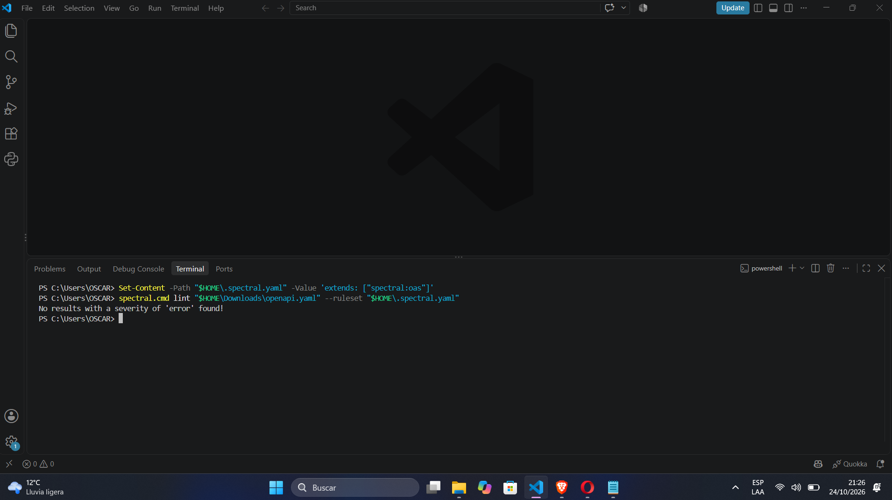

# Evidencias de validación – PUKAY

Esta carpeta contiene las evidencias de las herramientas utilizadas durante el desarrollo y validación del proyecto PUKAY.

## 1. Validación del contrato OpenAPI

- **Herramienta:** Spectral CLI 6.17.0
- **Archivo validado:** `api/openapi.yaml`
- **Especificación:** OpenAPI 3.0.3
- **Endpoints documentados:** 5
- **Errores detectados:** 0
- **Advertencias detectadas:** 0
- **Estado:** Validación satisfactoria.

### Resultado obtenido

La herramienta Spectral ejecutó la validación estática del contrato OpenAPI y mostró el siguiente mensaje:

`No results with a severity of 'error' found!`

Este resultado indica que no se encontraron errores según las reglas de validación configuradas.

### Evidencia

## 2. Relación con la cadena CASE

Esta evidencia corresponde a la etapa de especificación y validación del contrato de la API REST de PUKAY.

El contrato documenta los servicios de autenticación, registro, consulta, actualización y eliminación de actividades deportivas.
## 3. Evidencias de gestión de versiones y colaboración Git — Semana 3

Durante la Semana 3 se aplicaron prácticas de gestión de versiones, protección de ramas, revisión de cambios, resolución de conflictos y publicación de versiones en el repositorio PUKAY.

### 3.1. Protección de la rama principal

Se configuraron reglas de protección para la rama `main`, incluyendo el uso de Pull Requests y la aprobación de otros integrantes.

**Evidencias:**
- [Validación de CODEOWNERS](Codeowners-valido.png)
- [Prueba de protección de main](prueba-proteccion-main.md)
- [Archivo CODEOWNERS](../.github/CODEOWNERS)

### 3.2. Colaboración mediante Pull Requests

El equipo realizó cambios en ramas independientes y los integró mediante Pull Requests con revisión.

**Evidencias:**
- [Historial de Pull Requests](https://github.com/kellymoraj8-ops/dossier-pukay/pulls?q=is%3Apr+is%3Aclosed)
- [Pull Request #16 — Resolución del conflicto](https://github.com/kellymoraj8-ops/dossier-pukay/pull/16)
- [Pull Request #17 — Documentación de evidencias](https://github.com/kellymoraj8-ops/dossier-pukay/pull/17)

### 3.3. Resolución de un conflicto Git

Se provocó un conflicto mediante cambios realizados sobre la misma línea en ramas diferentes. GitHub detectó el conflicto y el equipo lo resolvió manualmente antes de integrar los cambios.

**Evidencias:**
- [Captura de conflicto detectado](conflicto-git-detectado.png)
- [Captura de marcadores de conflicto](conflicto-git-marcadores.png)
- [Prueba del conflicto](prueba-conflicto-git.md)
- [Documentación de la resolución](../docs/12-resolucion-conflicto-git.md)

### 3.4. Versionado semántico

Se publicó la versión `v0.3.0` de PUKAY siguiendo el esquema de versionado semántico.

**Evidencia:**
- [Release PUKAY v0.3.0](https://github.com/kellymoraj8-ops/dossier-pukay/releases/tag/v0.3.0)

### 3.5. Decisiones y comparación de herramientas

Se documentó la selección de Git frente a SVN mediante una matriz comparativa y una decisión arquitectónica.

**Evidencias:**
- [Matriz Git vs. SVN](../docs/08-matriz-git-vs-svn.md)
- [ADR-004 — Selección de Git](../docs/03-adr/ADR-004-seleccion-git.md)

### 3.6. Uso y contraste de inteligencia artificial

Se registró el apoyo de IA en las actividades de la Semana 3, indicando las verificaciones humanas y decisiones de aceptación o modificación.

**Evidencia:**
- [Registro de uso de IA](../docs/04-registro-ia.md)

---

**Conclusión:** Las evidencias permiten consultar las actividades de gestión de versiones y colaboración realizadas durante la Semana 3, así como sus resultados registrados en GitHub.
