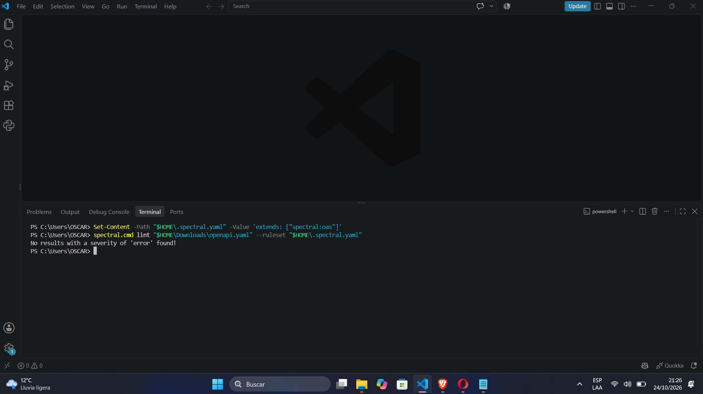

# Evidencias de validación – PUKAY

Esta carpeta contiene las evidencias de las herramientas utilizadas durante el desarrollo y validación del proyecto PUKAY.

## 1. Validación del contrato OpenAPI

- **Herramienta:** Spectral CLI 6.17.0
- **Archivo validado:** `api/openapi.yaml`
- **Especificación:** OpenAPI 3.0.3
- **Endpoints documentados:** 5
- **Errores detectados:** 0
- **Advertencias detectadas:** 0
- **Estado:** Validación satisfactoria.

### Resultado obtenido

La herramienta Spectral ejecutó la validación estática del contrato OpenAPI y mostró el siguiente mensaje:

`No results with a severity of 'error' found!`

Este resultado indica que no se encontraron errores según las reglas de validación configuradas.

### Evidencia

## 2. Relación con la cadena CASE

Esta evidencia corresponde a la etapa de especificación y validación del contrato de la API REST de PUKAY.

El contrato documenta los servicios de autenticación, registro, consulta, actualización y eliminación de actividades deportivas.
